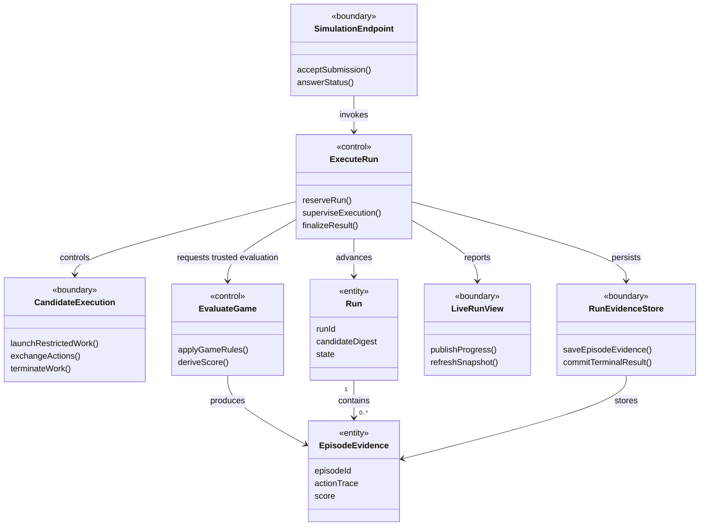
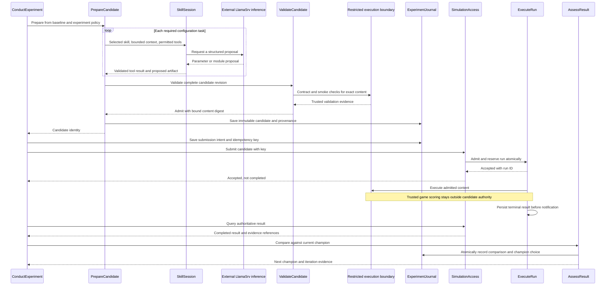
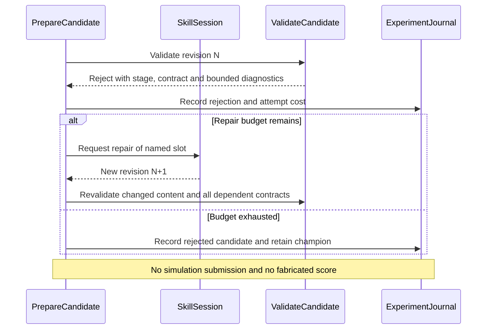
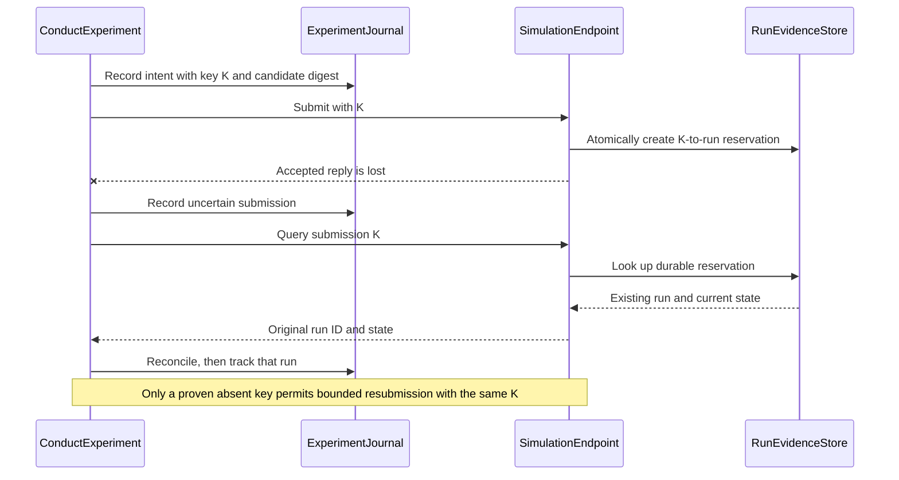
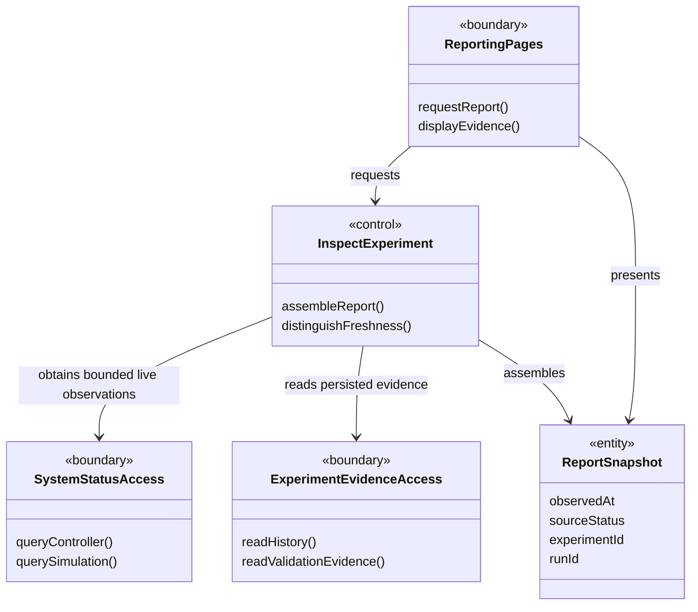
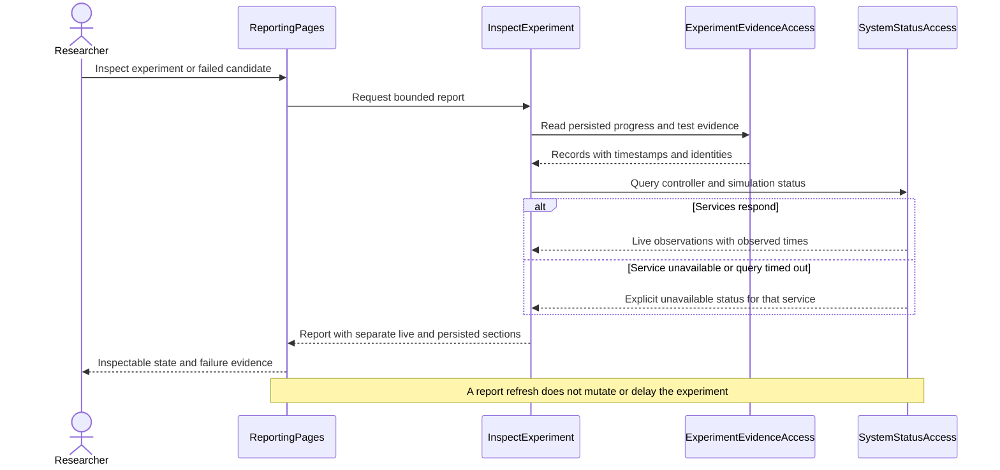

# Use cases and analysis model

[Overview](README.md) · [Skills and candidates](03-skills-and-candidates.md)

## Modeling convention

The Unified Process analysis model describes logical responsibilities needed to realize use cases. It is not a list of Python files, database tables or daemons. The analysis stereotypes below map to BMForge as follows:

| Analysis stereotype | BMForge classification | Meaning here |
| --- | --- | --- |
| `control` | Activity | Coordinates a use case or owns an application decision. |
| `boundary` | Interface | Mediates interaction with an actor, external technology or another responsibility boundary. |
| `entity` | Entity | Holds experiment data and results independently of transport or persistence. |

This is a project mapping, not a claim that every implementation adapter must be a Unified Process analysis class. Later design may split or combine responsibilities. `RNNModel.py` and its fellow writable slots are design-level extension contracts, not automatically entity classes because they contain model data. Systemd and socket topology appear in the separate [runtime view](04-runtime-and-integrity.md).

## Actors and use cases

Primary actor: the **researcher**, who starts/stops an experiment, chooses its policy and inspects evidence. The existing **inference service** is a supporting actor. The simulation server and restricted candidate executor are internal Nd3G subsystem boundaries, not independent product actors.

| Use case | Trigger and success condition | Important alternative |
| --- | --- | --- |
| UC1 Configure an experiment | Researcher selects a baseline and policy; a reproducible experiment record exists. | Missing model, module contract or execution capability prevents readiness. |
| UC2 Prepare a candidate | Controller requests parameter/module tasks; one complete, validated candidate is frozen. | Invalid output produces bounded repair feedback or a recorded rejection. |
| UC3 Execute a candidate | Frozen candidate is accepted once; a terminal run result is durably recorded. | Timeout, cancellation, process failure or resource violation cannot become a successful score. |
| UC4 Assess a result | Completed result is compared under the experiment policy; champion decision is recorded. | Tie/lower score retains the champion; incomparable/failed runs are excluded. |
| UC5 Observe/control a run | TUI shows progress and accepts permitted pause/resume/cancel controls. | Missed telemetry triggers snapshot refresh, not invented completion. |
| UC6 Recover an experiment | A service restarts or a response is lost; durable state resolves what happened. | Unresolvable outcome stops that experiment with actionable status. |
| UC7 Inspect and diagnose the system | Researcher opens the web report; current activity, persisted history, candidate/test evidence and failures are inspectable. | A stopped service or stale observation is labeled explicitly while available historical evidence remains readable. |

## Outer-loop analysis classes

### Responsibility boundaries

- **ConductExperiment** owns experiment progression, the task order, budgets, stop policy and restart position. It does not interpret Python source or issue SQL.
- **PrepareCandidate** assembles all required choices. **SkillSession** presents one skill's instructions, inputs and permitted tools to the LLM. Neither the model nor the skill decides whether a candidate passes admission.
- **ValidateCandidate** owns the admission decision based on complete-candidate checks and trusted validator results. It invokes execution through a restricted boundary; importing candidate modules in the controller is prohibited.
- **SimulationAccess** expresses submission/status/result operations in domain terms. It hides transport, not failure or uncertain outcomes.
- **AssessResult** applies the fixed comparison policy. It cannot accept an LLM claim of success as run evidence.
- **ExperimentJournal** abstracts durable progress and champion decisions. A later `ExperimentDb` interface owns SQL and composes with BMForge's unchanged `DbMgr`.
- **Candidate**, **RunResult**, **Experiment** and **Champion** carry values and identities. They do not save themselves, call LlamaSrv or own sockets. The diagram permits repeated evaluation of a candidate; a repetition is an explicit new run request, never a hidden retry.

## Simulation subsystem analysis classes

**EvaluateGame** owns legal transitions, termination and food-count score. Candidate code may propose actions and compute training rewards, but cannot mutate this state. The separation is logical here; the [execution design](04-runtime-and-integrity.md#trusted-scoring-and-generated-code) must realize it across a real privilege boundary or independently verify every scored action trace.

## UC2–UC4: normal experiment iteration

## UC2 alternative: a candidate is rejected

## UC6 alternative: the submit reply is lost

No diagram implies that today's SnakeLab already provides durable idempotency, a restart-safe queue or candidate isolation. Those are explicit Nd3G contract additions.

## UC7: integrated reporting responsibilities

**ReportingPages** translates requests and presents results, including safely escaped code/log text. **InspectExperiment** assembles domain views without changing the experiment. **SystemStatusAccess** reports the outcome and observation time of each live query, including timeout. **ExperimentEvidenceAccess** uses the application's named read-only data operations for history, candidate provenance, test reports and failures. **ReportSnapshot** carries values and freshness metadata. These analysis roles do not mandate a new generic reporting framework or a separate class for every page.

