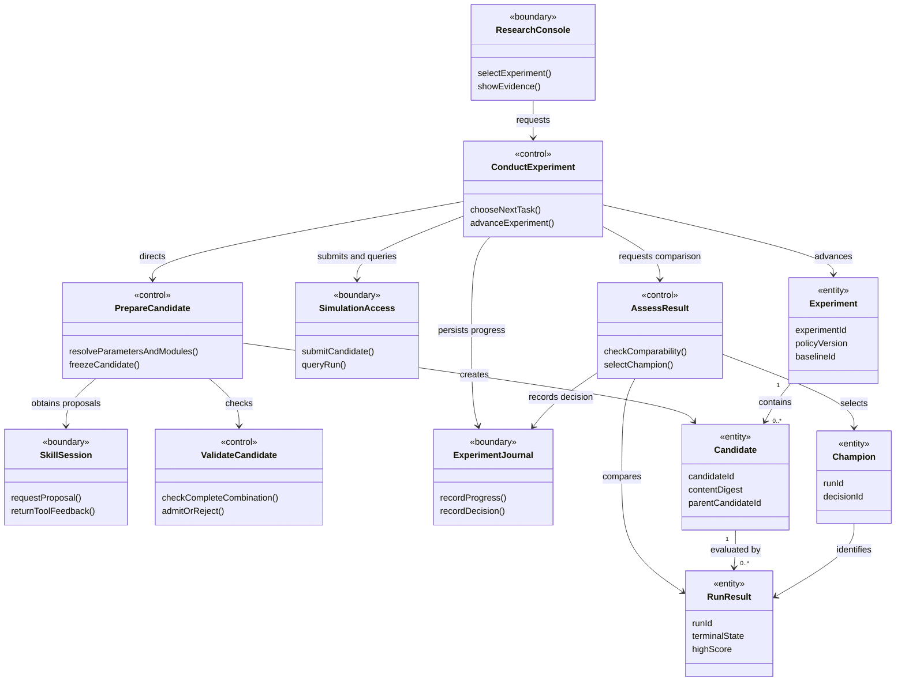
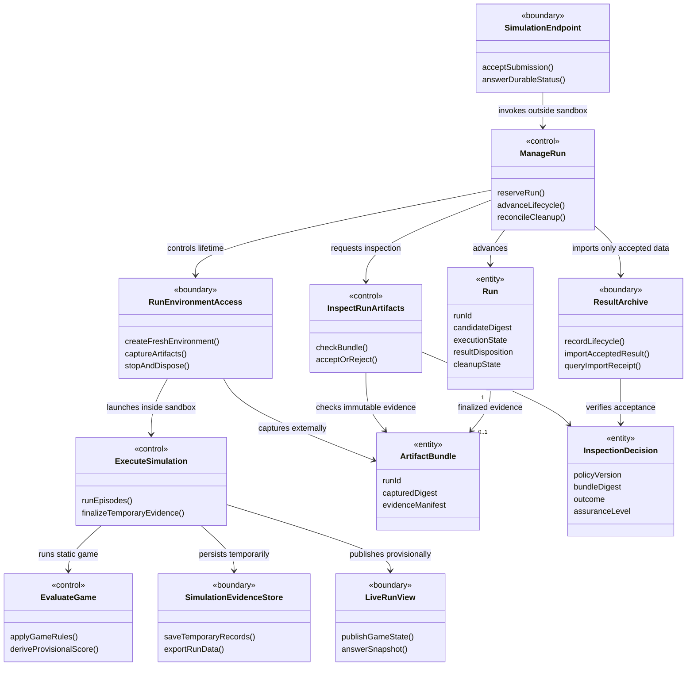
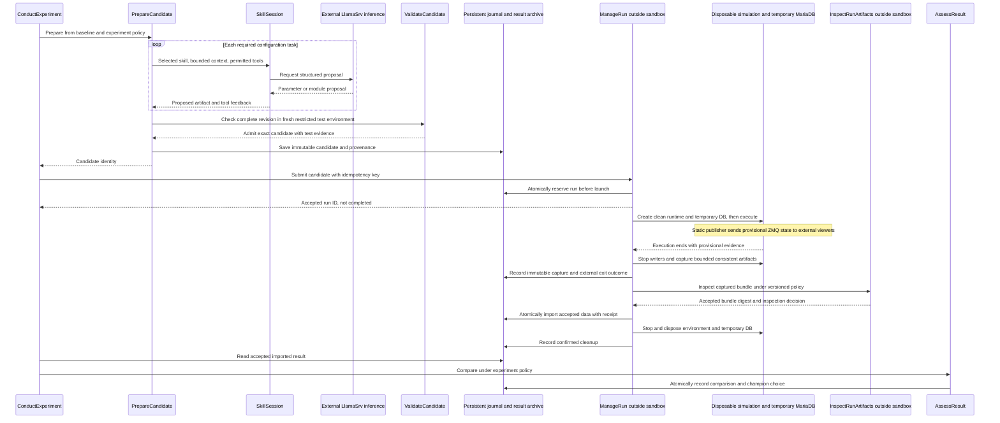
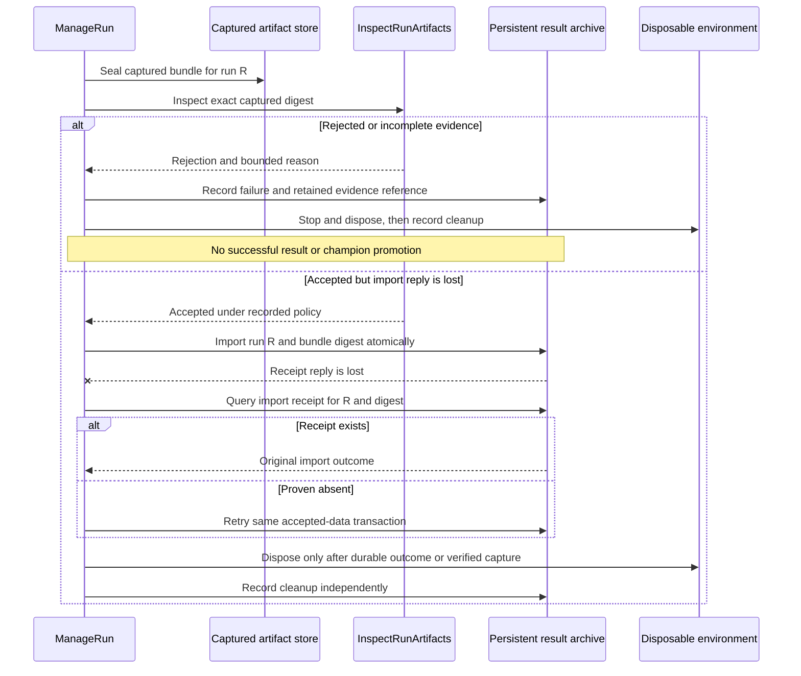
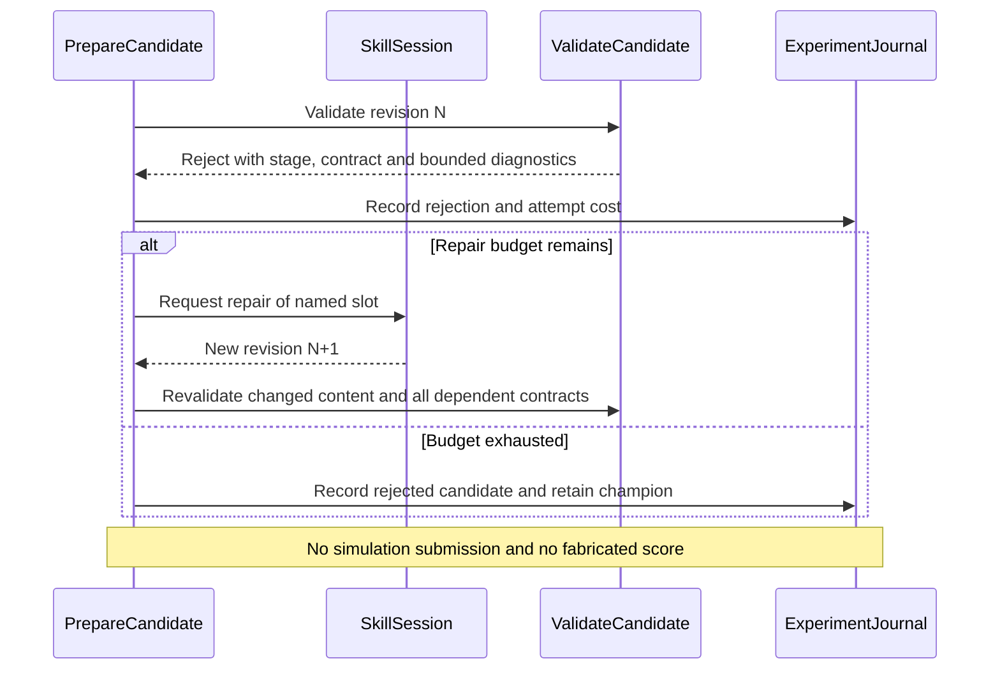
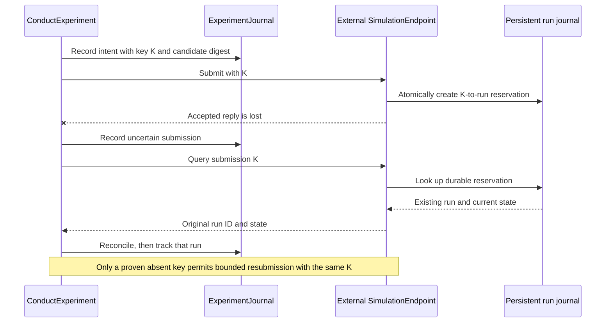
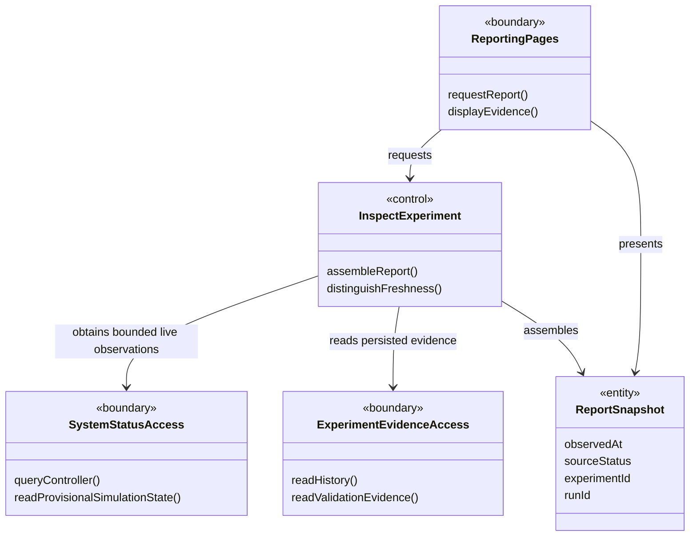
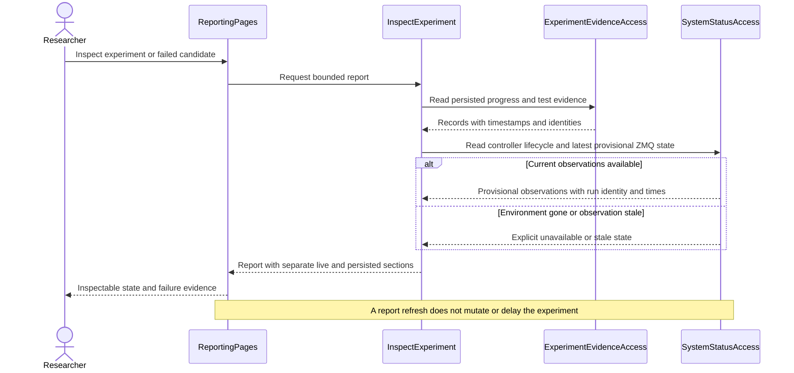

# Use cases and analysis model

[Overview](README.md) · [Skills and candidates](03-skills-and-candidates.md)

## Modeling convention

The Unified Process analysis model describes logical responsibilities needed to realize use cases. It is not a list of Python files, database tables or daemons. The analysis stereotypes below map to BMForge as follows:

| Analysis stereotype | BMForge classification | Meaning here |
| --- | --- | --- |
| `control` | Activity | Coordinates a use case or owns an application decision. |
| `boundary` | Interface | Mediates interaction with an actor, external technology or another responsibility boundary. |
| `entity` | Entity | Holds experiment data and results independently of transport or persistence. |

This is a project mapping, not a claim that every implementation adapter must be a Unified Process analysis class. Later design may split or combine responsibilities. `RNNModel.py` and its fellow writable slots are design-level extension contracts, not automatically entity classes because they contain model data. Systemd and socket topology appear in the separate [runtime view](04-runtime-and-integrity.md).

## Actors and use cases

Primary actor: the **researcher**, who starts/stops an experiment, chooses its policy and inspects evidence. The existing **inference service** is a supporting actor. The simulation server and disposable execution environment are internal Nd3G subsystem boundaries, not independent product actors.

| Use case | Trigger and success condition | Important alternative |
| --- | --- | --- |
| UC1 Configure an experiment | Researcher selects a baseline and policy; a reproducible experiment record exists. | Missing model, module contract or execution capability prevents readiness. |
| UC2 Prepare a candidate | Controller requests parameter/module tasks; one complete, validated candidate is frozen. | Invalid output produces bounded repair feedback or a recorded rejection. |
| UC3 Execute a candidate | Frozen candidate is accepted once; a fresh simulation environment produces captured evidence, inspected and imported before successful completion. | Timeout, rejection, failed import or cleanup is recorded distinctly; a sandbox completion flag is not a successful score. |
| UC4 Assess a result | Completed result is compared under the experiment policy; champion decision is recorded. | Tie/lower score retains the champion; incomparable/failed runs are excluded. |
| UC5 Observe/control a run | TUI shows progress and accepts permitted pause/resume/cancel controls. | External consumers distinguish provisional telemetry from accepted results and reconnect to the next run’s endpoint. |
| UC6 Recover an experiment | A service restarts or a response is lost; external durable intent, capture/import receipts and environment identity resolve what happened. | Unresolvable outcome stops that experiment with actionable status. |
| UC7 Inspect and diagnose the system | Researcher opens the web report; current activity, persisted history, candidate/test evidence and failures are inspectable. | A stopped service or stale observation is labeled explicitly while available historical evidence remains readable. |

## Outer-loop analysis classes

### Responsibility boundaries

- **ConductExperiment** owns experiment progression, the task order, budgets, stop policy and restart position. It does not interpret Python source or issue SQL.
- **PrepareCandidate** assembles all required choices. **SkillSession** presents one skill's instructions, inputs and permitted tools to the LLM. Neither the model nor the skill decides whether a candidate passes admission.
- **ValidateCandidate** owns the admission decision based on complete-candidate checks and trusted validator results. It invokes execution through a restricted boundary; importing candidate modules in the controller is prohibited.
- **SimulationAccess** expresses submission/status/result operations in domain terms. It addresses the persistent lifecycle owner outside the sandbox and hides transport, not failure or uncertain outcomes.
- **AssessResult** applies the fixed comparison policy. It reads only accepted imported results, never a sandbox or LLM claim of success.
- **ExperimentJournal** abstracts durable progress and champion decisions. A later `ExperimentDb` interface owns SQL and composes with BMForge's unchanged `DbMgr`.
- **Candidate**, **RunResult**, **Experiment** and **Champion** carry values and identities. They do not save themselves, call LlamaSrv or own sockets. The diagram permits repeated evaluation of a candidate; a repetition is an explicit new run request, never a hidden retry.

## Simulation subsystem analysis classes

**ManageRun** owns the durable lifecycle outside the disposable environment. **RunEnvironmentAccess** hides the selected launcher/capture/disposal technology, not uncertain outcomes. **ExecuteSimulation**, **EvaluateGame**, **SimulationEvidenceStore** and **LiveRunView** are static simulation responsibilities inside the environment. They use temporary MariaDB and invoke only the allowed generated slots. Neither a MariaDB process nor a systemd unit is itself an analysis class.

**InspectRunArtifacts** applies the selected inspection policy to externally captured immutable data; **ResultArchive** owns the persistent import and deduplication contract. Domain interfaces own SQL. Inspection acceptance, successful import and cleanup are distinct decisions/facts. Temporary records and ZMQ observations do not bypass this boundary. **EvaluateGame** owns legal transitions and food-count scoring in the static code, but shared-process Python can still alter runtime state; [result integrity](04-runtime-and-integrity.md#trusted-scoring-and-generated-code) remains an explicit design concern rather than an assumed guarantee.

## UC2–UC4: normal experiment iteration

The test environment is also disposable and uses the same approved runtime/policy; its state is not reused for the full simulation. Candidate admission and post-run result inspection are separate gates. The normal diagram assumes inspection accepts; the next alternative covers rejection and interrupted import.

If the archive is unavailable, stop execution and retain verified captured evidence for later reconciliation. Do not treat an unavailable receipt query as proof that import did not commit. Disposal failure is visible and blocks another environment launch; it does not erase an already accepted result.

## UC2 alternative: a candidate is rejected

## UC6 alternative: the submit reply is lost

The lost-reply reservation belongs to the external journal, never temporary MariaDB. No diagram implies that today's SnakeLab already provides durable idempotency, a restart-safe queue, inspected import or candidate isolation. Those are explicit Nd3G contract additions.

## UC7: integrated reporting responsibilities

**ReportingPages** translates requests and presents results, including safely escaped code/log text. **InspectExperiment** assembles domain views without changing the experiment. **SystemStatusAccess** consumes bounded ZMQ state from the static in-sandbox publisher and queries external lifecycle status or a bounded snapshot. It records run/publisher identity, observation time, timeout and stale/provisional state, without reading temporary MariaDB. **ExperimentEvidenceAccess** uses the application's named read-only data operations for history, candidate provenance, test reports and failures. **ReportSnapshot** carries values and freshness metadata. These analysis roles do not mandate a new generic reporting framework or a separate class for every page.

