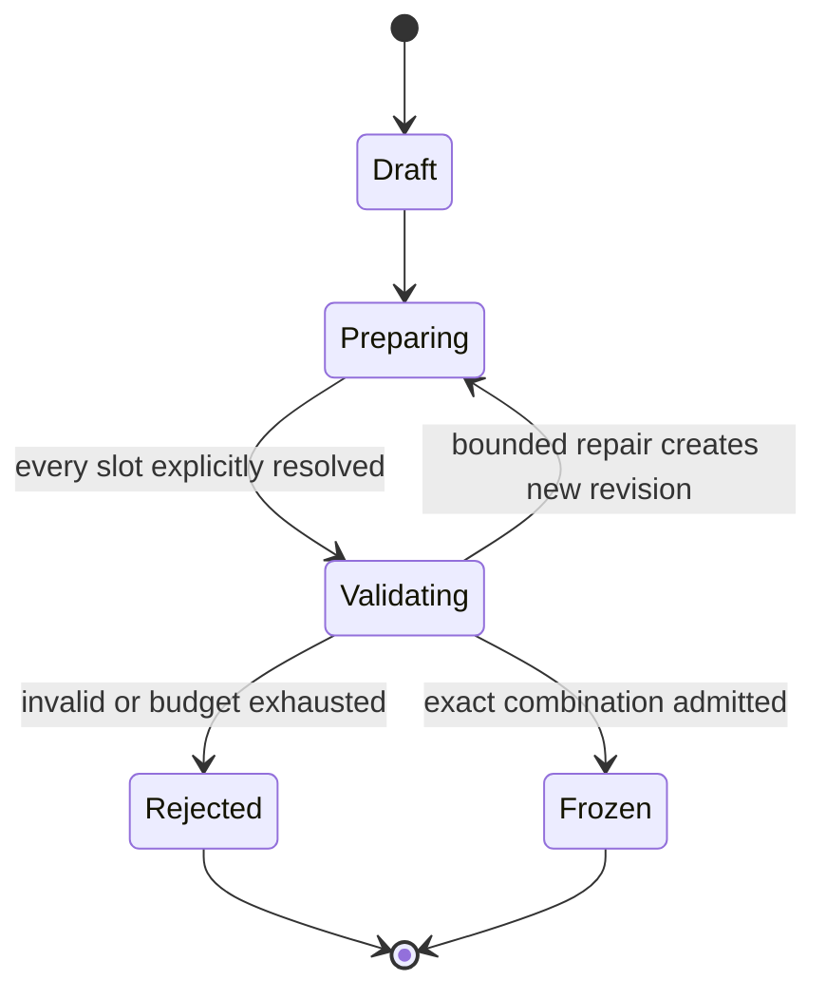

# Runtime skills and experiment contracts

[Overview](README.md) · [Runtime and integrity](04-runtime-and-integrity.md)

## Two different uses of skills

**Development-time BMForge skills** instruct a coding agent how to build Nd3G. They live in `.agents/skills/`, are pinned by the BMForge manager, and include specifications, references and acceptance checks. They are not executable application components and are not automatically suitable prompts for Qwen.

**Runtime experiment skills** are proposed Nd3G-owned, versioned task packages consumed by its skill host while experiments run. Each supplies a focused objective, input/output contract, examples, relevant reference material and a tool allowlist. The development-time BMForge component for this mechanism must be specified first; its eventual application implementation and runtime skill packages belong to Nd3G. A skill is still instructions plus resources, not an independent service, security boundary or proof of model competence.

The benefit over copying Ax3l's prompt architecture is explicit task packaging, selective context loading, per-task evaluation and reusable tool contracts. Prompts remain involved, but their responsibilities are smaller and the host has an inspectable execution contract.

## Minimal runtime skill host

Use a fixed registry of approved skills and tools, loaded at service startup. `ConductExperiment` chooses a task from the current experiment plan. The host loads only that skill's instructions, contract, relevant baseline modules and summarized evidence. Qwen may request the permitted tools and return proposed content; application code validates and executes requests. It cannot install a skill, change tool permissions or alter its own validator.

Each invocation records skill ID/version/digest, candidate revision, input references, model artifact/serving identity, inference settings, tool calls, validation feedback and final outcome. Define finite model-call timeouts, turn count, input/output byte limits and repair budget. A failure exhausts that task's budget and records rejection; it does not trigger an unbounded agent loop or silent fallback model.

Begin with the documented OpenAI-compatible llama.cpp interface. Verify native tool calls and structured output on the actual Qwen deployment during elaboration. Choose one supported protocol deliberately; do not ship an automatic alternate parser that silently treats arbitrary model prose as commands. A well-formed tool request is still untrusted input.

### Proposed task packages

| Runtime skill | Inputs | Output | Completion check |
| --- | --- | --- | --- |
| `configure-parameters` | Full parameter catalogue, baseline, prior comparisons, budget | Explicit complete parameter set and rationale | Schema, allowed ranges and cross-field rules pass. |
| `write-model` | Model slot contract, baseline source, resolved dimensions | Model artifact or explicit reuse reference | Shape/device/finite-output checks and parameter bounds pass. |
| `write-replay` | Transition/batch contract, capacity and sequence parameters | Replay artifact or reuse reference | Episode boundaries, buffer lifetime and memory bound checks pass. |
| `write-trainer` | Model/replay contracts, parameter set, training budget | Trainer artifact or reuse reference | A bounded update works; target/loss/gradient behavior matches its declared algorithm. |
| `write-reward` | Read-only transition facts, reward parameters, scoring distinction | Reward artifact or reuse reference | Finite scalar output, deterministic tests and no game-state authority. |

An optional result-explanation skill may summarize why a proposal helped, but cannot rank runs or promote a champion. Do not make it part of the first required loop. Model-authored tests may add useful examples, but never replace trusted admission tests.

### Supporting tools and authority

These are proposed domain operations, not a commitment to MCP or a new transport. The first host can dispatch registered in-process handlers; execution tools must cross the restricted executor boundary.

| Tool family | Allowed operation | Important limit |
| --- | --- | --- |
| Inspect | Read schema, named slot contract, baseline artifact, approved result summary | No arbitrary filesystem paths, secrets, service configuration or network browsing. |
| Propose | Set typed parameters; write one named module into the current candidate revision | No absolute paths, traversal, symlinks, extra entry points or edits outside allowed slots. |
| Validate | Request static checks, contract tests or a bounded smoke run | Host selects trusted checks and enforces time/resource budgets. No arbitrary command or test-runner replacement. |
| Explain | Attach rationale and expected effect | Rationale is evidence of intent, not evidence of validity or improvement. |

**Submit, cancel, champion promotion, dependency changes, service control and skill release are not LLM tools.** They are host or operator responsibilities. Candidate text, docstrings, logs and model responses are data; embedded instructions do not expand permissions. Tool outputs must be bounded and structured before entering the next model context.

## Complete candidate as the submission unit

A candidate manifest is a domain record, not a loose directory of editable files:

- identity, revision and parent/baseline candidate;
- complete resolved parameters and parameter-schema version;
- exact artifact ID and content digest for every required module slot, including unchanged slots;
- module-contract version and declared parameter consumption;
- host/evaluator revision, fixed game/observation/action contract and scoring-policy version;
- experiment-controlled episode/step/time budgets and seed plan;
- dependency/environment identity, resource envelope and required device capabilities;
- skill/model provenance and rationale;
- validation report bound to the candidate digest, validator revision and execution-policy version.

Retain exact module bytes and skill inputs alongside digests. A hash identifies content but does not authenticate an untrusted writer or prove safety. Artifact access, ownership and atomic finalization still matter. Any change after validation creates a new revision and invalidates the affected evidence. Changing a model or replay contract rechecks trainer integration too.

The controller submits only an immutable candidate reference plus an idempotency key. The simulation service resolves that reference from application-controlled storage, verifies its digest and validation/policy compatibility, and rejects incomplete content. Do not load Python from a remote URL or a writable developer checkout. In the initial same-host design, a finalized read-only artifact store avoids a new upload service. Remote execution would need an explicit transfer protocol.

This diagram describes candidate preparation only. `Frozen` completes preparation and preserves immutable content; it does not prevent later or repeated evaluation. Submission and evaluation never mutate the candidate or move it into a terminal run state. Each evaluation creates a separate `Run` with its own submission intent, idempotency key and lifecycle, as described in the runtime contract. An admitted candidate can have a failed run; a sent submission is not necessarily accepted; an accepted run is not completed. A repeated evaluation uses a new explicit run key and retains its relation to the same frozen candidate.

## Writable module contracts

The following contracts constrain behavior without prescribing exact Python signatures. Final signatures and approved dependency inventories are BMForge elaboration work.

| Slot | Responsibility and allowed variation | Required contract/invariants |
| --- | --- | --- |
| `RNNModel.py` | Map observation sequences to action values; vary recurrent internals within approved limits. | Input `[B,T,F]`, sequence output `[B,T,A]`, final output `[B,A]`; fixed observation/action meanings; finite values, declared dtype/device, seeded construction, bounded model size and serializable state. |
| `ReplayMemory.py` | Store transitions and sample training windows; vary sampling policy. | Fixed transition/batch types; no cross-episode windows; explicit insufficient-data result; bounded capacity; reproducible RNG; documented array ownership/lifetime. Preserve current final-transition supervision unless a new contract is approved. |
| `Trainer.py` | Update trainable state; vary the learning algorithm within the selected contract. | Accept the model and replay contracts; bounded update frequency; finite diagnostics; respect device/resource limits; own optimizer/target state; reset cleanly between runs. The initial reference is Double DQN, not a universal requirement for all later candidates. |
| `RewardFunction.py` | Compute the learning reward from immutable, allowed transition facts. | Pure finite scalar reward; no mutations to game state, legal actions, termination, score, seed schedule or run results. The host supplies inputs and records the returned reward separately from score. |

**Parameter/code consistency matters.** For each tunable field, declare which module or host policy consumes it. Host-owned constructor inputs and behavioral contract tests should prevent accidental omission. No simple static scan can prove that arbitrary Python genuinely uses a hyperparameter. Record a module's declared consumption, test meaningful observable constraints and reject a candidate when its declared schema is incompatible. A new algorithm that removes or redefines a parameter requires an explicit contract revision, rather than pretending to tune an ignored value.

The protected host owns observation encoding, action vocabulary, game rules, seed derivation, experiment budgets, authoritative metrics, result persistence, validators and tool permissions. The first reward extraction must keep the existing transition/score behavior unchanged when the baseline reward implementation is selected.

## Admission stages

These are the summary gates; [Generated-code risk mitigation](07-generated-code-risk.md) defines the test matrix, limitations and practical execution options.

1. **Non-executing checks:** complete manifest, exact field types, finite numbers, allowlisted slots/import inventory, syntax parsing, artifact size and canonical paths. These reduce accidents; they are not containment.
2. **Restricted import and module checks:** import and exercise modules only inside the selected restriction boundary. Check interfaces, tensor dimensions, replay boundaries, numerical failures and tested forbidden side effects. Passing those tests is not proof of harmlessness.
3. **Combined smoke evaluation:** all four modules plus parameters run together on bounded fixtures. Verify initialization, a learning cycle, action validity, baseline transition behavior and termination. Use the same declared runtime/dependency identity intended for the full simulation.
4. **Freeze and admit:** the trusted supervisor records test outcomes and binds them to exact artifact/contract/environment digests. Candidate-written output cannot issue its own admission record. Recheck those identities before activation in a fresh bounded run; do not overwrite installed application modules.

Admission failures remain distinct from poor scientific results. Record syntax/contract/numerical/resource/policy failures and repair cost, without assigning them a made-up high score. The last completed champion remains available.
