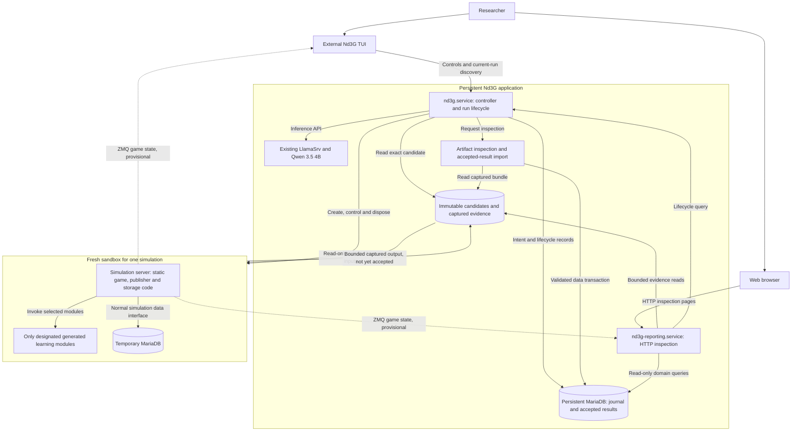

# Runtime boundaries and execution

[Overview](README.md) · [BMForge adoption](05-bmforge-and-delivery.md)

## Process and component view

This is a deployment/design view, separate from the analysis classes. The latest decision places the **whole simulation server and a temporary MariaDB instance inside one disposable environment per run**. The controller, persistent database, artifact inspection/import and web reporting stay outside. The simulation continues to use its normal application code and versioned persistence interfaces; the temporary database is not a second hand-crafted storage implementation.

`Artifact inspection and accepted-result import` is a logical activity within the controller's trusted application side, not a proposed extra daemon. The two long-running application services are controller and reporting. The simulation server is a separately managed process whose lifetime belongs to a run, with temporary MariaDB started before it inside the selected environment. Whether this uses systemd within a VM, a host-managed transient unit or another approved lifecycle mechanism remains a design choice. Do not retain a permanent host simulation server merely to preserve the earlier diagram.

The external lifecycle owner must remain able to time out, stop and dispose the whole environment even if simulation code hangs. It holds any launcher authority; neither generated code nor the sandbox receives a container-engine socket, host service-control capability or persistent-database credentials. The controller never imports candidate modules. LlamaSrv remains external and is called only through its inference API; Nd3G does not take ownership of the shared inference service.

Future `scripts/services start` starts reporting then controller; `stop` stops controller (including bounded active-environment cleanup) then reporting. The controller starts each temporary database, verifies schema/readiness, starts that run's simulation, and later stops and disposes both. Keep BMForge's sequential helper simple rather than using it as a job scheduler. Unit names, accounts, directories, readiness and shutdown deadlines belong to approved installation design. Reporting remains available during experiment shutdown and shows unavailable dependencies honestly.

## Disposable run lifecycle and data ownership

1. **Reserve outside the sandbox.** Persist run ID, candidate digest, execution-policy version and submission key in the persistent journal before launching anything. Initially allow one active simulation and a bounded queue. This journal survives loss of the entire environment.
2. **Create a clean environment.** Provision the approved runtime and exact tested module bytes, with a new temporary MariaDB data directory and run-local credentials. Initialize the same approved simulation schema/migrations and database interfaces used by the simulation. Do not clone production data, reuse another run's database, or expose persistent credentials. Each repeated evaluation is a new environment with fresh weights, replay, optimizer and exploration state.
3. **Run and observe.** Static simulation code runs the game, invokes the named modules, writes temporary results and publishes game state. External TUI/reporting consumers observe bounded ZMQ messages. The external lifecycle owner records launch identity, limits and independently observed exit/timeout status.
4. **Capture artifacts.** Stop simulation writers, finalize or snapshot temporary data consistently and produce a bounded export using application-owned code. Capture the run manifest, selected table data, episode/action evidence, metrics, winning frames and bounded diagnostics into a host-owned quarantine area. Record receipt and a digest outside the sandbox, then make the captured copy immutable. Files must be ordinary permitted outputs, not symlinks or paths that cause traversal. A digest detects later changes; it does not prove that sandbox output is true.
5. **Inspect before accepting.** An external activity checks identity, provenance, schema, counts, bounds, completeness, cross-record invariants and the selected score-verification policy. Record acceptance or rejection against that exact bundle. A sandbox's own test/completion flag cannot issue this decision. The inspection mechanism and its assurance level are still to be selected; routine decisions may be automated under an approved policy. Do not silently add a mandatory human review of every simulation.
6. **Import accepted data.** Use host-owned domain operations to map accepted data into persistent records, with one atomic transaction and an idempotent receipt keyed by run ID plus bundle digest. The same key/digest returns the existing receipt; a different digest is a conflict. Do not restore a candidate-supplied SQL dump, run its DDL/triggers/procedures, attach its database files to the persistent server or import Python objects. The temporary database reuses the simulation environment; the import boundary is a narrow data contract, not a second simulation database implementation.
7. **Dispose.** After a durable accepted-import receipt, or a durable rejection/failure record with the chosen retained evidence, remove the environment, temporary database, run-local credentials and mounts. Confirm cleanup separately. Only accepted imported results enter champion comparison. A cleanup failure does not roll back an already committed import; it blocks another launch until reconciled and remains visible in reporting.

The normal path is execute, capture, inspect, import, dispose. If inspection is deferred or storage/import is temporarily unavailable, stop the environment and retain bounded immutable evidence rather than leave untrusted code running indefinitely. Once durable capture is verified, compute resources may be disposed while inspection/import remains pending. This is an explicit recovery path, not permission to import before inspection or to delete the only evidence of a successful run. A configured retention deadline must end in an explicit discarded/rejected status, never a fabricated success.

Keep three related facts distinct: **execution outcome** (`queued`, `starting`, `running`, `paused`, `cancelling`, `exited`, `failed`, `cancelled`, `interrupted`), **result disposition** (`not_captured`, `captured`, `inspecting`, `rejected`, `accepted`, `imported`) and **cleanup** (`pending`, `disposed`, `failed`). Exact enum names are later design work. Reports show them together. A run is scientifically completed only after successful execution, required evidence inspection and persistent import; “process exited” alone is not completion.

### Recovery and consistency

- An immutable bundle plus an external journal lets a controller restart continue capture/inspection/import without repeating the simulation. An ambiguous database commit is resolved by querying the import receipt before retrying.
- Persist an environment identity before treating launch as successful. If creation times out, reconcile that identity rather than launch a duplicate. After a restart, find and stop or safely reconcile surviving work before any new run.
- A crashed run without complete captured evidence is `interrupted` or failed. Its diagnostics may be retained, but partial episodes are not silently imported as a completed high-score result. Running state cannot be reconstructed from temporary MariaDB alone after disposal.
- Inspection rejection preserves the prior champion and a bounded explanation. A retry of inspection/import uses the same immutable bundle; rerunning training requires an explicit new run identity and a fresh environment.
- Comparison and champion choice are committed atomically against the expected champion revision. Capture/import/disposal are not one distributed transaction; their durable receipts and reconciliation define recovery at each boundary.

## Communication contract

Reuse ZeroMQ for short control/query requests and separate live PUB/SUB observation. The control endpoint outside the sandbox exposes persistent submission/lifecycle queries; the in-sandbox server only controls its assigned run. The TUI resolves the active run's configured endpoint through that stable boundary. No broker or extra generic query daemon is required.

BMForge's inspected `bmforge.zmq-server` 0.4.0 is **REQ/REP only**, using a socket-owning thread. SnakeLab's asyncio control implementation and PUB/SUB channels are not compliant drop-ins. Adopt the approved control mechanics and domain handlers. Specify telemetry in BMForge first rather than claim its current skill already covers PUB/SUB.

Proposed envelope: BMForge's `protocol_version`, `sender`, `target`, `method`, object `payload`, plus specified `request_id` correlation. Validate exact types, finite values, encoding, payload size and response correlation. Routing labels are not authentication. Configure one local transport and its access controls; no automatic TCP/IPC fallback. A sandbox with internal MariaDB and outward ZMQ observation requires narrowly allowed endpoints, **not an absolute no-network claim**. Deny Internet/general host access and persistent DB reachability. Internal DB and approved control/telemetry channels are explicit exceptions, with access enforced by the selected mechanism.

| Operation | Responsibility and result |
| --- | --- |
| `submit`, `submission-status` | External lifecycle owner durably reserves candidate/key/run, or resolves the existing reservation after a lost reply. |
| `run-status`, `run-result` | External journal returns execution, capture, inspection, import and cleanup state; authoritative results come from accepted persistent records. |
| `active-run`, `snapshot` | Discover the current environment and obtain a bounded provisional snapshot without depending on prior PUB delivery. No active environment is a valid state. |
| `pause`, `resume`, `cancel` | External owner authorizes and tracks controls for the assigned run, forwarding only the narrow command. Cancellation is terminal only when work has stopped. |
| `high-score-snapshot`, `high-score-frames` | Serve accepted persisted winning evidence; label any live sandbox preview provisional. |
| `health` | Distinguish controller/reporting readiness, sandbox lifecycle, temporary DB readiness and persistent storage availability. |

Handlers return promptly after durable acceptance, not after a long simulation. Requests have finite overall deadlines and clear socket ownership. A timed-out mutation has an unknown outcome until reconciled. Same `(experiment_id, idempotency_key)` and candidate digest returns the original run; conflicting content is rejected. Retain the key with the experiment. Idempotency prevents duplicate admission, not magical exactly-once execution. Keep one bounded durable queue under the external owner.

The **static, non-LLM-writable publisher** emits run ID, candidate digest, publisher-instance identity, sequence, observation time and bounded game-state data. Both external consumers validate framing/types/sizes, reject mismatched or stale run identities, and escape generated text. PUB/SUB is best effort: queue overflow policy and local drop counters are explicit; dropped frames or disconnected consumers cannot stall training. A completion notification prompts a durable lifecycle query, never an automatic persistent result import. Late messages from a disposed environment cannot become the next run's state.

## Trusted scoring and generated code

The LLM's tool authority is restricted to the named source slots. Game rules, publisher, schema, export, validators and orchestration source are static and non-writable by the model. That supports a stable simulation and reuses existing infrastructure, but source immutability is not the same as process integrity. Arbitrary Python imported into the simulation process may affect objects or globals in memory, including code that writes temporary records or publishes state.

The outer sandbox primarily limits damage to the persistent application and host. Temporary MariaDB rows, messages and artifacts remain untrusted inputs to the external inspection step. Training reward stays separate from food-count score. An initial inspection can check structure, completeness and consistency, but those checks alone cannot certify gameplay or learning quality.

Choose and record the assurance needed before enabling generated-code scores for champion promotion. Options include trusted replay of complete action evidence under the fixed game/seed contract, or a protected game/learning process boundary **inside** the disposable environment. Both preserve the agreed whole-simulation sandbox. Replay can verify legal trajectories and derived scores, but does not by itself prove that the declared learned policy produced those actions. Stronger policy verification would require an additional designed and measured path. Do not silently mandate it or advertise stronger assurance than the selected inspection provides. Tests, source checks and human code review are useful evidence, not proof that arbitrary code is harmless.

Required restriction properties to specify and test:

- no persistent-database, LlamaSrv/control or host credentials, access to other runs, host source writes or privileged inherited handles;
- only run-local temporary DB access, explicitly bounded control/observation channels and no general network access;
- read-only approved runtime and candidate inputs, with private bounded scratch/output and a temporary database volume;
- bounded CPU, memory, process count, database/output size, wall time and device allocation;
- no authority over external validation/import receipts, persistent results, champion selection or cleanup;
- bounded whole-environment shutdown, including descendants and temporary database, with cleanup confirmation.

Select the containment mechanism from the [practical options](07-generated-code-risk.md#practical-containment-options) during BMForge elaboration. GPU exposure, native code and driver/kernel vulnerabilities remain material. Ordinary process memory limits do not promise GPU-memory containment. Admission tests run inside fresh environments under the selected policy from the first import; never test candidate imports on the host. Keep code mutation disabled if required controls or the accepted inspection policy are absent. These are design gates, not evidence that a sandbox has already been built or tested.

## Scoring, reporting and reproducibility

The initial champion rule remains Ax3l's: two completed, comparable runs with inspected, imported high scores; promote only if `candidate.high_score > champion.high_score`. Ties retain the champion. A failure, interruption or invalid run never counts as a zero-score completed run. Preserve episode counts, total steps, rewards, losses, high score, winning snapshot/frames and golden-history reporting where applicable, adding candidate/module/skill identities and failure categories.

Learning reward and food-count score are separate. A reward function cannot improve the experiment merely by returning larger numbers. Likewise, generated modules cannot increase the episode budget or change the board to manufacture higher records.

A single-run maximum is noisy and benefits from a larger search/episode budget. Keep it for continuity, but label it a best observed score rather than proof of general improvement. Supplement reports with seed, episode budget, parameter/code differences, compute cost and failure/repair counts. A later confirmation cohort with fixed seeds and repeated runs can assess robustness without silently replacing the existing champion rule. Recommended, pending confirmation against Ax3l's seed-rotation behavior: establish a fresh comparable baseline when rotating seeds. Do not compare across changed rules or budgets as if they were the same experiment.

Record software/dependency versions, hardware/device details, seed derivation, model/skill settings and exact artifacts. Reproduction means sufficient evidence to rerun under known conditions; bit-for-bit GPU determinism is not promised without testing the chosen stack.

## Integrated web reporting is required

Ax3l's useful precedent is an application-owned reporting server that exposes real system state and links directly from overview/event records to configuration, prompt/reply and simulation details. Its HTTP process is separate, but its reports are tightly connected to application records and live control queries. Some aggregate views are cached and refreshed after 60 seconds; do not mistake that cadence for a guarantee of live state. The [source register](06-sources.md#ax3l-reporting-evidence-for-the-second-draft) identifies the inspected code.

Nd3G should adopt that integration without copying Ax3l's cross-project SQL coupling or building an independent dashboard data model. Start with ordinary server-rendered pages and bounded queries, using the BMForge HTTP component. One `InspectExperiment` activity composes read-only application domain interfaces and live service observations. Do not add a reporting broker, projection daemon or separate visualization service.

### First working reporting slice

| View | Essential information and navigation |
| --- | --- |
| System overview | Controller/inference availability, sandbox and temporary DB lifecycle, current experiment and stage, active/queued run, selected champion, outstanding failure and observation times. |
| Experiment and run detail | Complete resolved configuration, candidate/module digests, seed and budget, progress, accepted result, comparison decision and winning-game evidence, plus separate execution/inspection/import/cleanup status. |
| Candidate and validation detail | Module source/diff as escaped text, parent candidate, skill/model identity, test stage/results, bounded diagnostics, repair attempts and rejection reason. |
| Filterable event history | Correlated experiment/candidate/run/task IDs, state transitions and timestamps, with links to exact evidence rather than only an undifferentiated log tail. |
| Dependency and failure detail | Timeouts, unavailable services, last persisted progress and resource/test failures. A stopped controller must remain diagnosable from available history. |

Expose enough bounded task input/output evidence to understand a failed skill invocation, while redacting secrets and treating all generated text as untrusted content. Use identifiers, not arbitrary filesystem paths, to retrieve stored artifacts. No Python deserialization or candidate import is needed to display a report.

### Ownership, freshness and failure semantics

- **One authoritative state model:** external experiment/run activities own durable lifecycle and accepted-result transitions; the temporary database contains provisional simulation evidence only. Reporting reads named operations on Nd3G-owned domain interfaces with read-only database credentials and separately owned connections. These are same-application interfaces, not imports from Ax3l or direct access to another application's database. SQL remains in domain interfaces, not pages or activities.
- **Live observation:** the external reporter consumes ZMQ game state from the static simulation publisher and uses bounded read-only queries for controller lifecycle or missing snapshots. It has no direct access to temporary MariaDB and never imports results. Show `observed_at`, service instance/revision and success/unavailable status. “Page refreshed” is not equivalent to “all sources are current.”
- **Persisted evidence:** display the latest recorded progress and its timestamp separately from the live observation. When live state is unavailable, historical evidence remains labeled historical; it is not silently promoted into a current status.
- **Consistency:** tie data to candidate/run IDs and capture a coherent persisted read where feasible. Separate live queries are not an atomic cross-process snapshot; if IDs/revisions differ, report the transition and refresh rather than merge them into an invented state.
- **Bounded work:** paginate event/evidence queries, cap diagnostic size and use short request deadlines. A slow browser or expensive report must not hold simulation locks or delay training. Start with manual or modest polling refresh; no WebSocket requirement.
- **Failure visibility:** a working report page can show an unhealthy dependency, and its health response should distinguish HTTP readiness from dependency health. Do not copy Ax3l's fixed-success health response. Show storage errors explicitly rather than render an empty successful history.
- **Restricted exposure:** initial pages are read-only and confined to the intended local/trusted deployment. Authentication and network exposure must be reviewed before wider access. Escape code, logs and model text; do not allow HTML/script execution from candidate content.

The separate external HTTP process keeps inspection available after a controller crash, simulation failure or sandbox disposal. It reads persistent accepted results and captured evidence, not a live temporary database. No extra generic query service is needed.

### Optional visualizations

Text, tables and linked detail pages satisfy the essential inspection requirement. High-score history, learning curves, comparison plots or dependency graphs are useful later when they answer a concrete question. Select BMForge's approved visualization capabilities only then, hosted by this same reporting server. Neither a plotting package nor a background aggregate-refresh service is required for the initial reporting slice.

## TUI alongside web reporting

Reuse the existing board, plots and run controls. Likely changes include endpoint/package names, the new envelope and result-query contract, candidate/module identities, provisional/accepted status and per-run endpoint discovery/reconnect/snapshot handling. Endpoints expire with the environment; consumers must clear stale state and resolve the next run explicitly. The current client already speaks SnakeLab-specific contracts, so “minor tweaks” is a hypothesis to validate, not a guarantee.

Live messages are disposable: bounded queues, documented overflow policy, publisher-instance identity and sequence numbers aid diagnosis. A sequence cannot reveal drops occurring before numbering unless local drop counters are also exposed. Completion notifications prompt a durable query. A TUI disconnect or slow subscriber must not stall the experiment.

The TUI specializes in real-time board/learning views and existing run controls; the required web server specializes in navigable state, history and troubleshooting evidence. Both consume the same domain meanings. Browser-based mutation controls are a later decision, not implied by a reporting requirement.
