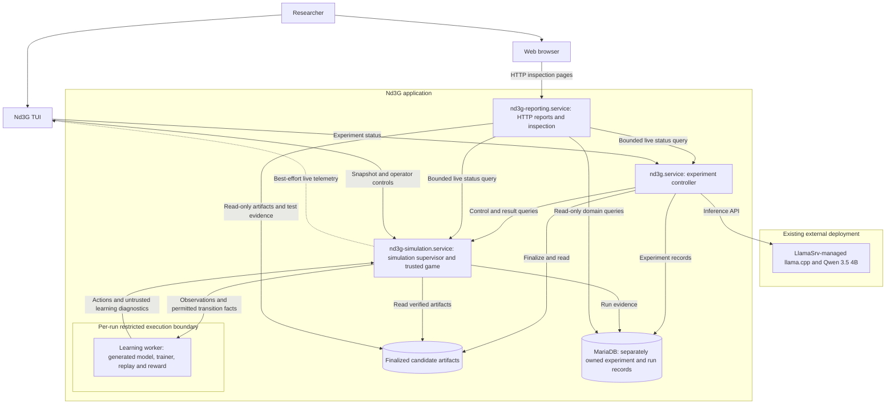

# Runtime boundaries and execution

[Overview](README.md) · [BMForge adoption](05-bmforge-and-delivery.md)

## Process and component view

This is a deployment/design view, separate from the analysis classes. Unit names and placement are proposed. The recommended topology now has three long-running Nd3G services: controller, simulation and reporting. Web reporting is required; a separate reporting process is the recommended placement because it can remain available when an experiment service fails.

The learning worker is a bounded child workload, not another permanent systemd daemon. The simulation supervisor remains responsive while learning code runs and owns cancellation/time limits. Execution may require an isolated launcher or systemd transient scope; the mechanism is an open, security-relevant design decision, not an already selected dependency.

The controller never imports candidate modules. It calls the existing inference endpoint, not the unauthenticated LlamaSrv control panel. It has no reason to restart or reconfigure the shared inference service. Starting Nd3G should check inference readiness and report a failure rather than take ownership of LlamaSrv.

For the application-owned services, future `scripts/services start` should start reporting, simulation, then controller; `stop` should stop controller, simulation, then reporting. The report server starts with explicit unavailable statuses until its live sources respond and remains useful while the experiment services stop. Its own required storage/configuration failure still fails readiness visibly. Keep the sequential helper required by BMForge. Unit dependency/readiness semantics, least-privilege service accounts, directories, resource limits and shutdown deadlines belong to the approved installation specification, not this documentation change.

## Communication contract

Reuse ZeroMQ for short control/query requests, with handlers returning promptly after durable acceptance. Preserve separate control and observation concerns, not the old protocol byte for byte. Deliberately adapt the TUI and controller to one new contract rather than add legacy compatibility shims.

BMForge's inspected `bmforge.zmq-server` 0.4.0 is **REQ/REP only**, using a socket-owning thread. SnakeLab's asyncio control implementation and PUB/SUB channels are not compliant drop-ins. Adopt BMForge's control mechanics and domain handlers. Introduce the needed telemetry specification in BMForge first; do not claim its current skill already authorizes PUB/SUB or asyncio transport infrastructure.

Proposed envelope: BMForge's `protocol_version`, `sender`, `target`, `method`, object `payload`, plus an explicitly specified `request_id` correlation contract. A version is an integer, not a Boolean. Validate finite numeric payloads, Unicode, size, method and exact response correlation. Routing labels are not authentication. Use one configured local endpoint transport, with access controls and no automatic TCP/IPC fallback. Remote access needs a separate security review.

| Operation | Responsibility and result |
| --- | --- |
| `submit` | Candidate digest plus idempotency key; return run ID and accepted state only after reservation is durable. |
| `submission-status` | Resolve an idempotency key after a lost reply, including after restart. |
| `run-status`, `run-result` | Authoritative current/terminal state and persisted result, not only in-memory objects. |
| `active-run`, `snapshot` | Reconstruct live display and detect no active run without requiring event delivery. |
| `pause`, `resume`, `cancel` | Operator controls with explicit state/result semantics and bounded acknowledgement. |
| `high-score-snapshot`, `high-score-frames` | Preserve current winning-game inspection and animation inputs. |
| `health` | On-demand readiness of required application dependencies through existing interfaces. |

Transport requests have finite overall deadlines and explicit socket ownership. A timed-out mutation has an unknown outcome until reconciled. The domain layer, not a generic transport retry loop, owns any permitted retry.

### Submission and state ownership

- The controller durably writes submission intent before sending. The simulation service atomically reserves `(experiment_id, idempotency_key)` with the candidate digest and run ID. Same key/same digest returns the existing run; same key/different content is a conflict.
- A durable queued-run record is the source of truth. An in-memory queue is at most a scheduling aid. Begin with one executing run and a small, explicitly bounded admission capacity; no broker or distributed scheduler is needed.
- Persist terminal results before publishing notifications. Retain deduplication records at least as long as experiment records, and never permit an expired key silently to mean a new run.
- Idempotency prevents duplicate admission, not magical exactly-once execution. Record execution attempts. After supervisor failure, reconcile/terminate any surviving child before another attempt. Mark a lost running attempt `interrupted`; do not resume training weights implicitly. A fresh run requires an explicit experiment-policy decision and a new run identity.
- On controller restart, query the saved key/run, recover an already committed comparison and continue from durable progress. Commit comparison and champion choice atomically, using the expected champion revision so a stale result cannot overwrite a later choice.

Proposed run states: `queued`, `running`, `paused`, `cancelling`, and terminal `completed`, `failed`, `cancelled`, `interrupted`. Queued cancellations never execute. Cancellation acknowledgement is not terminal cancellation; the supervisor confirms the child stopped before finalization. A paused process after service restart is interrupted unless a separately designed checkpoint capability exists.

## Trusted scoring and generated code

Code generation expands the trust boundary. Read-only source files, Python AST filters, import allowlists, a subprocess, systemd restart policy and per-process service separation do **not** by themselves stop malicious Python, native extensions, resource exhaustion or score fabrication. A staged [test-before-activation gate](07-generated-code-risk.md) is the first practical mitigation, but tests must themselves run in the restricted environment: importing a module already executes its top-level code.

Recommended realization to validate during elaboration: the trusted game/evaluator remains outside the candidate's restricted process. It owns legal moves, food placement, collisions, termination, episode budgets and score. The learning worker receives bounded observations/transition facts and returns actions. The supervisor validates these inputs and derives metrics itself. Candidate-reported reward/loss is labeled learning telemetry, never authoritative score. This is an integrity design choice with latency and throughput costs to measure, not a claim that process separation alone enforces it.

An alternative is isolated whole-simulation execution followed by trusted replay of the **full** action evidence for every scored episode, using fixed seeds and evaluator revision. It may reduce per-step boundary overhead, but validation cost and completeness are substantial. Verifying only the claimed winning frame or a candidate-supplied summary is insufficient. Benchmark the recommended per-step boundary before choosing the alternative.

Required restriction properties, to be specified and tested before generated code runs:

- no database credentials, LlamaSrv/service-control credentials, host secrets, writable application source, other runs or controller sockets;
- no network access and no inherited privileged handles;
- read-only approved runtime/artifacts and a bounded private scratch area;
- bounded CPU, memory, process count, file output, wall time and device allocation;
- no ability to write authoritative result records, validator results or game state;
- bounded shutdown that terminates descendants and records failure visibly.

Select a concrete containment mechanism and its approved modules in BMForge from the [practical options](07-generated-code-risk.md#practical-containment-options). GPU access is especially important: device exposure, drivers and native libraries can weaken isolation, and GPU-memory limits are not automatically enforced by ordinary systemd memory controls. Before enabling code-mutating experiments, review what the chosen mechanism actually enforces and explicitly accept its residual risk; parameter-only experiments using trusted fixed modules remain a separate eligible stage. This is a design gate, not a guarantee that finite tests prove total security.

## Scoring, reporting and reproducibility

The initial champion rule remains Ax3l's: two completed, comparable runs with recorded high scores; promote only if `candidate.high_score > champion.high_score`. Ties retain the champion. A failure, interruption or invalid run never counts as a zero-score completed run. Preserve episode counts, total steps, rewards, losses, high score, winning snapshot/frames and golden-history reporting where applicable, adding candidate/module/skill identities and failure categories.

Learning reward and food-count score are separate. A reward function cannot improve the experiment merely by returning larger numbers. Likewise, generated modules cannot increase the episode budget or change the board to manufacture higher records.

A single-run maximum is noisy and benefits from a larger search/episode budget. Keep it for continuity, but label it a best observed score rather than proof of general improvement. Supplement reports with seed, episode budget, parameter/code differences, compute cost and failure/repair counts. A later confirmation cohort with fixed seeds and repeated runs can assess robustness without silently replacing the existing champion rule. Recommended, pending confirmation against Ax3l's seed-rotation behavior: establish a fresh comparable baseline when rotating seeds. Do not compare across changed rules or budgets as if they were the same experiment.

Record software/dependency versions, hardware/device details, seed derivation, model/skill settings and exact artifacts. Reproduction means sufficient evidence to rerun under known conditions; bit-for-bit GPU determinism is not promised without testing the chosen stack.

## Integrated web reporting is required

Ax3l's useful precedent is an application-owned reporting server that exposes real system state and links directly from overview/event records to configuration, prompt/reply and simulation details. Its HTTP process is separate, but its reports are tightly connected to application records and live control queries. Some aggregate views are cached and refreshed after 60 seconds; do not mistake that cadence for a guarantee of live state. The [source register](06-sources.md#ax3l-reporting-evidence-for-the-second-draft) identifies the inspected code.

Nd3G should adopt that integration without copying Ax3l's cross-project SQL coupling or building an independent dashboard data model. Start with ordinary server-rendered pages and bounded queries, using the BMForge HTTP component. One `InspectExperiment` activity composes read-only application domain interfaces and live service observations. Do not add a reporting broker, projection daemon or separate visualization service.

### First working reporting slice

| View | Essential information and navigation |
| --- | --- |
| System overview | Controller/simulation/inference availability, current experiment and stage, active/queued run, selected champion, outstanding failure and observation times. |
| Experiment and run detail | Complete resolved configuration, candidate/module digests, seed and budget, progress, authoritative result, comparison decision and winning-game evidence. |
| Candidate and validation detail | Module source/diff as escaped text, parent candidate, skill/model identity, test stage/results, bounded diagnostics, repair attempts and rejection reason. |
| Filterable event history | Correlated experiment/candidate/run/task IDs, state transitions and timestamps, with links to exact evidence rather than only an undifferentiated log tail. |
| Dependency and failure detail | Timeouts, unavailable services, last persisted progress and resource/test failures. A stopped controller must remain diagnosable from available history. |

Expose enough bounded task input/output evidence to understand a failed skill invocation, while redacting secrets and treating all generated text as untrusted content. Use identifiers, not arbitrary filesystem paths, to retrieve stored artifacts. No Python deserialization or candidate import is needed to display a report.

### Ownership, freshness and failure semantics

- **One authoritative state model:** experiment/run activities own transitions. Reporting reads named operations on Nd3G-owned domain interfaces with read-only database credentials and separately owned connections. These are same-application interfaces, not imports from Ax3l or direct access to another application's database. SQL remains in domain interfaces, not pages or activities.
- **Live observation:** bounded read-only queries ask each owning service for transient status. Show `observed_at`, service instance/revision and success/unavailable status. “Page refreshed” is not equivalent to “all sources are current.”
- **Persisted evidence:** display the latest recorded progress and its timestamp separately from the live observation. When live state is unavailable, historical evidence remains labeled historical; it is not silently promoted into a current status.
- **Consistency:** tie data to candidate/run IDs and capture a coherent persisted read where feasible. Separate live queries are not an atomic cross-process snapshot; if IDs/revisions differ, report the transition and refresh rather than merge them into an invented state.
- **Bounded work:** paginate event/evidence queries, cap diagnostic size and use short request deadlines. A slow browser or expensive report must not hold simulation locks or delay training. Start with manual or modest polling refresh; no WebSocket requirement.
- **Failure visibility:** a working report page can show an unhealthy dependency, and its health response should distinguish HTTP readiness from dependency health. Do not copy Ax3l's fixed-success health response. Show storage errors explicitly rather than render an empty successful history.
- **Restricted exposure:** initial pages are read-only and confined to the intended local/trusted deployment. Authentication and network exposure must be reviewed before wider access. Escape code, logs and model text; do not allow HTML/script execution from candidate content.

The separate HTTP process is recommended because inspection survives a controller crash or deliberate stop. Hosting HTTP within the controller is a smaller alternative, but loses that diagnostic independence and requires care around thread/state ownership. Either uses the same inspection contract; no further generic query service is needed.

### Optional visualizations

Text, tables and linked detail pages satisfy the essential inspection requirement. High-score history, learning curves, comparison plots or dependency graphs are useful later when they answer a concrete question. Select BMForge's approved visualization capabilities only then, hosted by this same reporting server. Neither a plotting package nor a background aggregate-refresh service is required for the initial reporting slice.

## TUI alongside web reporting

Reuse the existing board, plots and run controls. Likely changes include endpoint/package names, the new envelope and result-query contract, candidate/module identities, validation status and reconnect/snapshot handling. The current client already speaks SnakeLab-specific contracts, so “minor tweaks” is a hypothesis to validate, not a guarantee.

Live messages are disposable: bounded queues, documented overflow policy, publisher-instance identity and sequence numbers aid diagnosis. A sequence cannot reveal drops occurring before numbering unless local drop counters are also exposed. Completion notifications prompt a durable query. A TUI disconnect or slow subscriber must not stall the experiment.

The TUI specializes in real-time board/learning views and existing run controls; the required web server specializes in navigable state, history and troubleshooting evidence. Both consume the same domain meanings. Browser-based mutation controls are a later decision, not implied by a reporting requirement.
