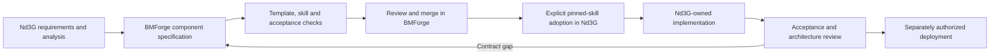

# BMForge adoption and iteration plan

[Overview](README.md) · [Source register](06-sources.md)

## Specification first, application adoption second

This proposal belongs in Nd3G because it defines the application. It does not change BMForge specifications, install optional skills or imply that proposed technologies are approved. Subsequent work must preserve the repository boundary:

1. Agree on Nd3G use cases, responsibility boundaries and acceptance scenarios.
2. Introduce or amend each required component **in BMForge**, with a specification ID/version/status, approved runtime-module inventory, references/templates, skill packaging and acceptance checks. Record policy decisions in BMForge's decision record.
3. Review and merge that BMForge work. A draft specification label is not evidence of implementation readiness.
4. With explicit adoption approval, install/update the relevant pinned Nd3G skills and lock. Do not hand-edit their vendored instructions or import BMForge at runtime.
5. Implement application-owned activities, interfaces and entities in a separately authorized Nd3G task. Copy the canonical `DbMgr` unchanged if selected; put SQL in domain `*Db` interfaces.
6. Pass component acceptance checks in Nd3G, record the literal `BMFORGE_COMPONENT` marker in each owning module and update the changelog. The marker states provenance, not certified compliance.

## Component inventory and gaps

| Component/capability | Current evidence | Proposed next work |
| --- | --- | --- |
| Project, constants, localization, installation | Already pinned in Nd3G; installation stubs do not deploy the runtime. | Keep pins unchanged for this proposal. Complete actual two-service lifecycle before first release; source-language UI keys from the first feature. |
| Control/query transport | BMForge `bmforge.zmq-server` 0.4.0, draft, REQ/REP with thread-owned sockets. Not installed in Nd3G yet. | Explicitly select it; specify Nd3G envelope correlation and domain admission/query semantics without replacing its approved infrastructure. |
| Durable data access | BMForge `bmforge.db-server` 0.5.0, draft, MariaDB/PyMySQL. Not installed in Nd3G yet. | Select after architecture approval; unchanged manager, separate experiment/run interfaces and owned tables. Use required charset/collation and application-mediated health checks. |
| Live telemetry | SnakeLab has PUB/SUB reference behavior; current BMForge REQ/REP skill does not cover it. | New telemetry component specification for framing, socket ownership, bounded queues, drops, restart identity and snapshot reconciliation. |
| Runtime task skills and inference client | No inspected BMForge component establishes this contract. | New component for task-package format, registry, narrow tool dispatch, bounded inference interaction, audit and model/skill evaluation. Do not assume the HTTP-server component supplies an inference client. |
| Candidate artifacts and restricted execution | Generated module admission and isolation are new requirements. | New component for immutable bundles, validation evidence, restricted execution, resource controls and trusted output boundary. Select containment technology and dependencies before implementation. |
| Configurable learning modules | Current SnakeLab code is a reference, not a modular code-generation contract. | Nd3G-driven BMForge component for model/replay/trainer/reward slots and fixtures. Inventory existing PyTorch/NumPy needs explicitly; no arbitrary packages in candidates. |
| TUI | Existing Textual client is useful source behavior, not a selected BMForge runtime inventory. | Specify the reused client boundary and approved dependencies before adaptation; no UI rewrite by default. |

The last four rows are **proposed capabilities**, not existing skill IDs or released components. Their final grouping/names should follow actual reuse and acceptance boundaries. Do not create a generic framework merely because multiple responsibilities are documented.

Keep Nd3G domain policies in Nd3G: what a high score means, the seed schedule, champion selection, candidate task ordering and report content. BMForge defines how component contracts are built and adopted. Its specification can include the required Nd3G module contracts without importing live application code or imposing Snake mechanics on unrelated applications.

## Unified Process-style iterations

Use-case-driven, architecture-centric and risk-first iterations avoid treating these documents as a waterfall contract. Each iteration yields reviewed evidence, not simply more class names.

| Stage | Narrow outcome | Exit evidence |
| --- | --- | --- |
| Inception | Agree on experiment scope, baseline, success definition and writable slots. | R1–R12 traced; open decisions assigned; baseline records identified. |
| Elaboration A | Prove the LlamaSrv skill interaction and complete-candidate contract. | Representative Qwen parameter and code tasks measured for valid outputs, repair cost and context limits; no claim based on model size alone. |
| Elaboration B | Prove the execution/score boundary on the intended host. | Untrusted code cannot access protected data or fabricate score; timeout/child cleanup and GPU constraints tested. Unsafe capability remains disabled if the gate fails. |
| Construction A | Establish two services with trusted fixed learning modules. | Serial parameter-only loop, persistent results, current scoring, TUI observation and restart reconciliation pass end to end. |
| Construction B | Enable bounded module variation incrementally. | Reward slot first after extraction tests; then model/replay/trainer with combined contract tests. Each slot has independent versioned fixtures. |
| Construction C | Refine runtime skills using experiment evidence. | Compare parameter-only versus parameter-plus-code under declared budgets; inspect code and failed attempts, not only record wins. |
| Transition | Complete and validate installation, operations and reproducibility. | Install/upgrade/uninstall, service helper, health, ownership/version records and operator documentation verified before authorized deployment. |

These are future implementation increments. This PR supplies analysis only and does not execute them. No dates or performance guarantees are inferred.

## Architecture acceptance scenarios

| Scenario | Expected evidence | Requirements |
| --- | --- | --- |
| All current knobs represented | Nine current tunable values are explicitly resolved; fixed values and seed policy are separately identified. | R6, R8 |
| Missing or changed artifact | Missing slot, modified digest or stale validation prevents admission; previous champion stays intact. | R7, R8 |
| Cross-module mismatch | Model/replay/trainer dimension or parameter incompatibility fails before a scored run. | R7, R8 |
| Malformed/looping model response | Structured error and bounded repair/turn budget; no fabricated tool execution. | R2, R10 |
| Candidate tries to forge score | Trusted game result remains authoritative; forged metrics cannot become a champion. | R1, R7, R9 |
| Candidate hangs or allocates excessively | Defined resource failure, descendants stopped, supervisor responsive, no credential/source access. | R3, R4, R7 |
| Lost submit response | Query by persistent idempotency key returns the original run; no duplicate admission. | R3, R8 |
| Restart at each state transition | Durable records reconcile queued/running/terminal states; interrupted work never silently resumes or becomes completed. | R3, R4, R9 |
| Telemetry lost or TUI detached | Simulation continues; snapshots/results recover the view; completion is not inferred from PUB delivery. | R5, R9 |
| Reward magnitude increases | Training reward may change while food-count score remains independently computed. | R1, R7, R9 |
| Run ties or fails | Tie retains champion; failed run is excluded, with clear cause and cost. | R1, R9 |
| Component adopted | Exact approved pin, module inventory, provenance marker and consumer acceptance evidence exist. | R11 |

## Open decisions for architecture review

1. **Execution boundary:** which containment mechanism is practical on the host, especially with GPU access? Recommended gate: prove isolated learning with trusted external game evaluation before enabling generated code.
2. **Resource policy:** choose CPU/GPU placement, hard limits, repair/turn budgets, maximum source size and admission capacity. LlamaSrv and simulation may contend for the same GPU; do not assume concurrent operation is free.
3. **Experiment comparison:** confirm Ax3l's 1500-episode baseline and seed-rotation policy, and whether repeated confirmation runs should be a separate reporting cohort. Preserve the current high-score rule unless explicitly changed.
4. **Runtime skill protocol:** verify actual llama.cpp/Qwen native tool and structured-output support, then select one explicit supported contract and context budget.
5. **Expansion of the search space:** begin with the nine current values and four named module slots; decide which additional hyperparameters/algorithm variants warrant the next contract version.
6. **Observation interface:** validate the cost of adapting the existing TUI. Defer a browser UI unless source/history comparison makes it worth the additional component scope.
7. **Persistence organization:** recommend one application-owned database with explicit experiment/run table ownership and separate domain interfaces; decide final schema and artifact retention/backup policy during design. The controller accesses simulation results through its domain API, not ad hoc joins into simulation tables.

## Verification of this documentation change

- Inspected repository requirements, pinned baseline skills, BMForge component specifications and representative active Ax3l/SnakeLab/LlamaSrv code.
- Materialized Nd3G's pinned files and verified their hashes with the offline BMForge `verify` operation. No skills were updated.
- The normal BMForge update check was unavailable in the connector-materialized workspace because it lacked the expected Git/cache checkout. The separately inspected upstream source revision matched Nd3G's lock; that observation is not a substitute for a successful local update check.
- This is not an application test result or evidence of runtime isolation. Proposed acceptance scenarios remain to be implemented and run in later work.
