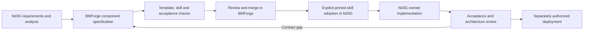

[Overview]({{ site.baseurl }}) · [Source register]({{ site.baseurl }})

## Specification first, application adoption second

This proposal belongs in Nd3G because it defines the application. It does not change BMForge specifications, install optional skills or imply that proposed technologies are approved. Subsequent work must preserve the repository boundary:

1. Agree on Nd3G use cases, responsibility boundaries and acceptance scenarios.
2. Introduce or amend each required component **in BMForge**, with a specification ID/version/status, approved runtime-module inventory, references/templates, skill packaging and acceptance checks. Record policy decisions in BMForge's decision record.
3. Review and merge that BMForge work. A draft specification label is not evidence of implementation readiness.
4. With explicit adoption approval, install/update the relevant pinned Nd3G skills and lock. Do not hand-edit their vendored instructions or import BMForge at runtime.
5. Implement application-owned activities, interfaces and entities in a separately authorized Nd3G task. Copy the canonical `DbMgr` unchanged if selected; put SQL in domain `*Db` interfaces.
6. Pass component acceptance checks in Nd3G, record the literal `BMFORGE_COMPONENT` marker in each owning module and update the changelog. The marker states provenance, not certified compliance.

## Component inventory and gaps

| Component/capability | Current evidence | Proposed next work |
| --- | --- | --- |
| Project, constants, localization, installation | Already pinned in Nd3G; installation stubs do not deploy the runtime. | Keep pins unchanged for this proposal. Complete the actual persistent controller/reporting and disposable simulation/database lifecycle before the first runtime release; source-language UI keys from the first feature. |
| Control/query transport | BMForge `bmforge.zmq-server` 0.4.0, draft, REQ/REP with thread-owned sockets. Not installed in Nd3G yet. | Explicitly select it; specify Nd3G envelope correlation and domain admission/query semantics without replacing its approved infrastructure. |
| Durable data access | BMForge `bmforge.db-server` 0.5.0, draft, MariaDB/PyMySQL. Not installed in Nd3G yet. | Select after architecture approval; unchanged manager, separate domain interfaces and owned tables. Reuse approved simulation schema/migrations in temporary MariaDB, with only accepted data crossing into persistent storage through an atomic idempotent import. Use required charset/collation and application-mediated health checks. |
| Required web reporting | Ax3l has an independent HTTP reporting process integrated with its state/events. BMForge HTTP 0.5.1 supplies app-owned HTTP/Jinja2 patterns; it is not installed in Nd3G yet. | Select the HTTP skill explicitly during implementation. Build read-only state, history, candidate and test-detail pages using the same application domain records and bounded live queries. Follow autoescaping, request limits, truthful health and local-time display requirements. |
| Optional reporting visuals | BMForge visualization 0.1.0 provides capability-selected approved browser libraries. | Add only useful charts/graphs to the existing reporting server. Text/tables/detail pages need no visualization library; do not add a visualization service. |
| Live telemetry | SnakeLab has PUB/SUB reference behavior; current BMForge REQ/REP skill does not cover it. | New telemetry specification for a static in-sandbox publisher and external TUI/report consumers, narrow permitted endpoints, framing, socket ownership, bounded queues, drops, per-run identity and snapshot reconciliation. |
| Runtime task skills and inference client | No inspected BMForge component establishes this contract. | New component for task-package format, registry, narrow tool dispatch, bounded inference interaction, audit and model/skill evaluation. Do not assume the HTTP-server component supplies an inference client. |
| Candidate artifacts and restricted execution | Generated module admission and isolation are new requirements. | Specify immutable inputs, whole-simulation environment lifecycle with temporary MariaDB, capture/inspection/import receipts and disposal, plus resource controls. Keep the launcher and persistent credentials outside. Select containment technology and inspection assurance before implementation; group capabilities sensibly rather than create a framework. |
| Configurable exploration | AI Hydra documents and implements epsilonNice as an optional post-epsilon, score-stagnation-enabled detour layer; no Nd3G component is installed. | Specify a small application-owned exploration component in BMForge first: fixed reference behavior, probability/steps configuration, static collision/activation boundaries, RNG/state lifetime and telemetry/test contract. Keep MCTS/ATH recovery out of scope; a generated-code slot is a separate decision. |
| Configurable learning modules | Current SnakeLab code is a reference, not a modular code-generation contract. | Nd3G-driven BMForge component for model/replay/trainer/reward slots and fixtures. Inventory existing PyTorch/NumPy needs explicitly; no arbitrary packages in candidates. |
| TUI | Existing Textual client is useful source behavior, not a selected BMForge runtime inventory. | Specify the reused client boundary and approved dependencies before adaptation. Retain its real-time simulation role alongside required web inspection. |

Rows that call for a new component are **proposed capabilities**, not existing skill IDs or released components. Their final grouping/names should follow actual reuse and acceptance boundaries. Do not create a generic framework merely because multiple responsibilities are documented.

Keep Nd3G domain policies in Nd3G: what a high score means, the seed schedule, champion selection, candidate task ordering and report content. BMForge defines how component contracts are built and adopted. Its specification can include the required Nd3G module contracts without importing live application code or imposing Snake mechanics on unrelated applications.

## Unified Process-style iterations

Use-case-driven, architecture-centric and risk-first iterations avoid treating these documents as a waterfall contract. Each iteration yields reviewed evidence, not simply more class names.

| Stage | Narrow outcome | Exit evidence |
| --- | --- | --- |
| Inception | Agree on experiment scope, baseline, reporting requirement, success definition and writable slots. | R1–R18 traced; reviewed assumptions retained; open decisions assigned; baseline records identified. |
| Elaboration A | Prove the LlamaSrv skill interaction and complete-candidate contract. | Representative Qwen parameter and code tasks measured for valid outputs, repair cost and context limits; no claim based on model size alone. |
| Elaboration B | Evaluate the test/containment/score boundary on the intended host. | Baseline simulation and temporary MariaDB run in fresh environments; test capture, inspection/import recovery and full disposal. Run module tests and policy probes under the same limits. Select containment and inspection assurance after measuring feasibility; document residual risk. Code mutation stays disabled when required controls are absent. |
| Construction A | Establish controller, simulation and reporting with trusted fixed learning modules. | Serial parameter-only loop creates and disposes an environment per simulation. Establish the unchanged Nice-disabled baseline, then the fixed epsilonNice component with bounded configuration and controlled fixtures. Inspected import, current scoring, external ZMQ observation, web reports and restart reconciliation pass end to end. Reports remain useful after environment disposal. |
| Construction B | Enable bounded module variation incrementally. | Reward slot first after extraction tests; then model/replay/trainer with combined contract tests. Each slot has independent versioned fixtures. |
| Construction C | Refine runtime skills using experiment evidence. | Compare parameter-only versus parameter-plus-code under declared budgets; inspect code and failed attempts, not only record wins. |
| Transition | Complete and validate installation, operations and reproducibility. | Install/upgrade/uninstall, service helper, health, ownership/version records and operator documentation verified before authorized deployment. |

These are future implementation increments. This PR supplies analysis only and does not execute them. No dates or performance guarantees are inferred.

## Architecture acceptance scenarios

| Scenario | Expected evidence | Requirements |
| --- | --- | --- |
| All current knobs represented | Nine original Ax3l values remain explicitly resolved; epsilonNice selection/settings, fixed activation contract and seed policy are separately identified. | R6, R8 |
| Missing or changed artifact | Missing slot, modified digest or stale validation prevents admission; previous champion stays intact. | R7, R8 |
| Cross-module mismatch | Model/replay/trainer dimension or parameter incompatibility fails before a scored run. | R7, R8 |
| Malformed/looping model response | Structured error and bounded repair/turn budget; no fabricated tool execution. | R2, R10 |
| Candidate tries to forge score | Selected inspection rejects malformed/inconsistent metrics and meets its explicitly recorded score-assurance contract. Strong replay/evaluation claims require specific tests; shape checks alone are not proof. | R1, R7, R9, R14 |
| Candidate hangs or allocates excessively | Defined resource failure, environment and descendants stopped, external lifecycle owner responsive, no host or persistent-credential access. | R3, R4, R7 |
| Lost submit response | Query by persistent idempotency key returns the original run; no duplicate admission. | R3, R8 |
| Restart at each state transition | External records reconcile launch, capture, inspection, import and cleanup; interrupted work never silently resumes or becomes completed. | R3, R4, R9 |
| Telemetry lost or TUI detached | Simulation continues; provisional snapshots recover the live view and persistent accepted results recover history. Old environment messages are rejected; completion is not inferred from PUB delivery. | R5, R9 |
| Reward magnitude increases | Training reward may change while food-count score remains independently computed. | R1, R7, R9 |
| Run ties or fails | Tie retains champion; failed run is excluded, with clear cause and cost. | R1, R9 |
| Component adopted | Exact approved pin, module inventory, provenance marker and consumer acceptance evidence exist. | R11 |
| Module tested before activation | Import/contract/invariant and combined smoke tests run under selected restrictions; admission binds to the exact artifact and environment; a changed artifact is retested. | R7, R8, R14 |
| Report during service failure | Web pages distinguish live unavailable state from timestamped persisted evidence and link to the failed task/run. No empty-success or fabricated current state. | R3, R4, R13 |
| Untrusted text in a report | Candidate source, model output and logs display as escaped bounded text, never execute as HTML/script or Python objects. | R13, R14 |
| Reporting load and freshness | Paginated reads and bounded live queries do not block training; a page refresh cannot mark stale data fresh. Essential reports work without optional chart libraries. | R9, R13 |
| Fresh environment per simulation | Every run gets clean learning state, temporary DB and run-local credentials, using the approved schema/interfaces; no previous-run state leaks. | R4, R15, R16 |
| Invalid or hostile export | Unexpected tables, executable SQL/Python objects, path traversal, oversized evidence or mismatched identities are rejected without persistent result changes. | R14, R16 |
| Crash during accepted-data import | Receipt lookup resolves uncertain commit; same run/digest cannot duplicate rows and a conflicting digest is rejected. | R9, R16 |
| Inspection rejects output | Rejection and bounded evidence survive disposal; no champion promotion or fabricated zero-score success. | R1, R14, R16 |
| Cleanup fails or controller restarts | External environment identity locates surviving resources; new launch is blocked until reconciled; accepted import is not undone. | R3, R15, R16 |
| Static publisher and external viewers | LLM writes only named slots. External consumers validate bounded ZMQ payloads and label them provisional; no persistent DB credentials or direct temporary DB reads. | R7, R13, R17 |
| epsilonNice gate and arming | Disabled/gated passthrough, boundary probabilities, next-step arming and exact detour length match the chosen contract. | R6, R8, R18 |
| epsilonNice action and learning evidence | Only safe alternatives excluding the suggestion are sampled when available; fallback preserves the suggestion. Replay records the executed action and static collision semantics remain unchanged. | R1, R7, R18 |
| epsilonNice state and observations | Score-based enable/disable, episode-boundary behavior, fresh run state, seeded choices, counter definitions and final partial-window capture are tested. No silent fifth code slot, ATH or MCTS dependency. | R9, R13, R15, R18 |

## Open decisions for architecture review

1. **Sandbox mechanism:** the entire simulation and temporary MariaDB are inside a fresh per-run environment. Choose the least complex OS/container/VM mechanism whose tested restrictions and residual risk are acceptable; review GPU access separately. Test before activation, but do not equate passing tests with containment.
2. **Resource policy:** choose CPU/GPU placement, hard limits, repair/turn budgets, maximum source size and admission capacity. LlamaSrv and simulation may contend for the same GPU; do not assume concurrent operation is free.
3. **Experiment comparison:** confirm Ax3l's 1500-episode baseline and seed-rotation policy, and whether repeated confirmation runs should be a separate reporting cohort. Preserve the current high-score rule unless explicitly changed.
4. **Runtime skill protocol:** verify actual llama.cpp/Qwen native tool and structured-output support, then select one explicit supported contract and context budget.
5. **Exploration configurability:** epsilonNice is now included. Recommend a fixed implementation with LLM-configurable probability/steps and explicit optional selection, retaining the ordinary epsilon schedule and four generated-code slots. Decide whether epsilonNice source should also become a fifth slot; separately set tuning limits and the versioned activation/reset semantics. Reference defaults are not automatic Nd3G policy. Other algorithm extensions remain separate contract changes.
6. **Inspection and result assurance:** choose the automated checks and any human-review triggers for captured output, and the strength needed before champion promotion. Compare structural/consistency checks with full replay or protected game/learning execution inside the sandbox. Specify what each establishes, what it does not and its throughput cost. TUI/reporting consumers remain external; exposure/authentication details still need design.
7. **Data handoff and retention:** temporary MariaDB per simulation and a separate persistent database are decided. Specify the minimal data-only export, schema version compatibility, import identity mapping, inspection receipts, bounded quarantine retention and backup policy. Prefer an atomic accepted-result import through existing domain interfaces; do not adopt wholesale database restore as a shortcut.

## Verification of this documentation change

- Reread current `dev` at release 0.1.1, confirmed PRs #1 and #2 merged, and preserved released changelogs and repository instructions. Inspected pinned AI Hydra documentation, policy/algorithm, composition, stagnation, configuration, RNG and reporting code; no Hydra or Nd3G application tests were executed. This revision changes analysis documentation only.
- Materialized current documentation and the pinned BMForge lock. Offline `verify` passed all local pin hashes; no skill/dependency/runtime changes were made. The normal update check remains unavailable in this connector-materialized workspace because it is not a Git checkout with the expected upstream cache. No claim of newest-upstream currency is made.
- Mermaid parsing, relative links/heading targets, Markdown fences, changelog structure and an independent architecture review are checked against the final revision before publication. The PR records the exact validation outcome and any limits.
- Prior-draft sources and review dates remain in the source register. This is not an application test result or evidence of real sandbox enforcement, secure import or runtime recovery. Proposed acceptance scenarios remain to be implemented and run in separately authorized work.

---

[Documentation index]({{ site.baseurl }})
